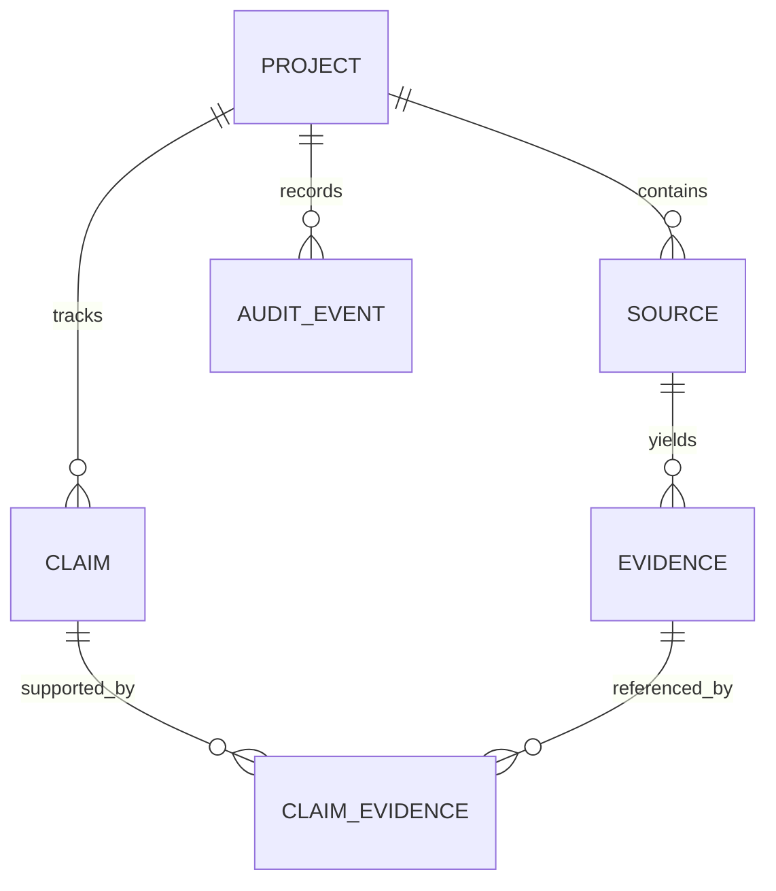

# Domain model

A claim is a time-bounded assertion about the project, not a raw LLM paragraph. Evidence is an immutable excerpt with a locator. `ClaimEvidence.relation` distinguishes support from contradiction. A future `ClaimVersion` and `Relationship` table will represent supersession, ownership, dependency and decision lineage without overwriting prior knowledge.
